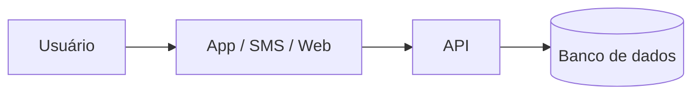

# Para detectar contas laranja de jovens com revisão humana, contestação rápida e prevenção


## Integrantes


| Nome completo (ordem alfabética) | GitHub | Área de carreira | RGM |
|---|---|---|---|
| [Nome] | [@usuario] | [Área] | [RGM] |
| [Nome] | [@usuario] | [Área] | [RGM] |
| [Nome] | [@usuario] | [Área] | [RGM] |


**Dossiê:** 2 Crime organizado no ambiente digital: aliciamento online e contas laranja.
 
**Recorte:** Contas de pessoas de 16 a 24 anos em bancos digitais e fintechs, nas etapas de detecção precoce de contas laranja e de prevenção.

## 1. Análise do problema

### 1.1 Quem é afetado, onde e quanto

* Escala das contas laranja. A Serasa Experian estimou que mais de 2,6 milhões de pessoas ou contas tinham indícios de atuar como "perfil laranja" em 2025, com crescimento de mais de 60% em dois anos e cerca de 1,2 bilhão de transações Pix associadas (aprox. 2% do total nacional). Apenas 3,2% desses perfis foram detectados pelas instituições (Serasa Experian, mar/2026; Olhar Digital, 2026).
* Peso no Pix. As instituições participantes do Pix identificaram 328.945 contas laranja em 2024, associadas a cerca de 27% das fraudes do sistema (Viva/Broadcast, set/2025).
* Perfil. Jovens e pessoas de baixa renda concentram a maioria das vítimas, segundo a Quod (BP Money, 2026); a Serasa mostrou que perfis com baixo uso de serviços financeiros foram 9 vezes mais arriscados que os de alto uso (Serasa Experian, 2026).


### 1.2 Causas
[Destaque para as causas tecnológicas: sistemas, dados, redes, decisões de projeto]

* Escala e velocidade do Pix. Transferência instantânea reduz a janela de resposta; o baixo uso da conta ampliou o espaço para contas de passagem.
* Aliciamento em ambientes pouco moderados. Jogos online e apps de mensagem servem de porta de entrada, e as plataformas respondem de forma desigual (Folha/Bem Paraná, 2026).
* Detecção tardia e fragmentada. Só 3,2% dos perfis laranja foram detectados em 2025. Cada instituição vê apenas parte do caminho do dinheiro, enquanto os criminosos fazem o dinheiro passar por várias contas em minutos, e as contas intermediárias cresceram 62% desde 2023 (Olhar Digital, 2026).

### 1.3 O que já existe e por que não basta

* BC Protege+ (dez/2025)	Permite à pessoa pedir que não abram conta em seu nome (Agência Gov, 2025)	Protege a vítima de identidade usada sem consentimento; não resolve quem empresta a conta

## 2. Proposta tecnológica


### 2.1 A solução, do ponto de vista do usuário
[O que é, para quem, e como funciona passo a passo]


### 2.2 Arquitetura





[Que dados entram, onde ficam e quem acessa]


### 2.3 O trabalho de cada área


#### [Área 1]
#### [Área 2]
#### Como as áreas se complementam


### 2.4 O que a tecnologia não resolve


## 3. Análise ética


### 3.1 Matriz de riscos (mínimo 5)


| # | Risco | Classificação | Impacto (quem e quão grave) | Controle |
|---|---|---|---|---|
| 1 | | [ético / legal-privacidade / segurança / viés-inclusão / governança] | | |


### 3.2 Decisão
**[Implantar | Implantar com controles | Não implantar ainda]**
[Justificativa em até 10 linhas]


### 3.3 Controles antes de entrar em produção


| Eixo | Controle | Quem faz | Como saber que foi cumprido |
|---|---|---|---|
| Transparência | | | |
| Revisão humana | | | |
| Minimização de dados | | | |
| Segurança | | | |
| Teste de viés | | | |
| Canal de contestação | | | |


### 3.4 LGPD


| Dado pessoal | Finalidade | Base legal | Por quanto tempo | Sensível ou de criança/adolescente? |
|---|---|---|---|---|
| | | | | |


### 3.5 Comunicado público


> [Texto de até 600 caracteres para o LinkedIn da consultoria]


**Contagem:** [N] caracteres


## 4. Acessibilidade e inclusão digital


### 4.1 Quem pode ficar de fora


| Grupo | Barreira | O que a solução faz |
|---|---|---|
| | | |


### 4.2 Requisitos de acessibilidade
[Requisitos concretos, com o critério WCAG correspondente]


## 5. Sustentabilidade


### 5.1 Impacto ambiental da solução
### 5.2 Sustentabilidade do projeto
[Quem mantém, quem paga, o que acontece depois do primeiro ano]


## 6. Impacto esperado


### 6.1 Indicadores


| Indicador | Como medir | Meta | Prazo |
|---|---|---|---|
| | | | |


### 6.2 Como os usuários serão ouvidos
### 6.3 Se a solução não pegar


## 7. Quadro de decisões (mínimo 5)


| Decisão | Alternativas consideradas | Por que escolhemos esta |
|---|---|---|
| | | |


## 8. Capítulos individuais


### 8.1 [Nome do integrante] — [Área]


**Papel no projeto:** [pelo que respondeu e o que produziu]


**Plano de desenvolvimento**


| Competência que a solução exige | Técnica ou comportamental | Já tenho? |
|---|---|---|
| | | |


**Metas SMART (6 a 12 meses)**
1. [Específica, mensurável, atingível, relevante e com prazo]


**Feedback dos colegas**
[Avaliação construtiva e propositiva, escrita em conjunto pelos demais integrantes]


### 8.2 [Próximo integrante] — [Área]
### 8.3 [Próximo integrante] — [Área]
### 8.4 [Próximo integrante (se houver)] — [Área]
### 8.5 [Próximo integrante (se houver)] — [Área]


## 9. Referências


- [Autor ou órgão]. *[Título]*. [Veículo], [data]. [link]
````


