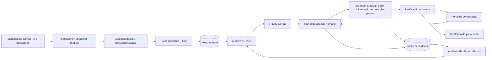

# Detecção precoce de contas laranja entre jovens, com revisão humana, contestação rápida e prevenção

## Integrantes

| Nome completo (ordem alfabética) | GitHub | Área de carreira | RGM |
|---|---|---|---|
| Kayk Alberto Santana Ferreira | [@Kayksantanaf] | Engenharia de Dados | 47792426 |
| Maria Clara Farias Coelho | [@mariaclarafarias1806-web]| Engenharia de Dados | [RGM] |
| Miguel Marcos da Silva Gonçalves | [@GitHub do Miguel] | Engenharia de Dados | [47963549] |

**Dossiê:** 2. Crime organizado no ambiente digital: aliciamento online e contas laranja.

**Recorte:** contas de pessoas de 16 a 24 anos em bancos digitais e fintechs, nas etapas de detecção precoce de contas laranja e de prevenção.

**Justificativa do recorte:** o dossiê trata de aliciamento online, e é entre jovens que a oferta de "dinheiro fácil" por redes sociais e jogos tende a encontrar menos defesa e menos informação sobre as consequências legais (hipótese que o piloto deve medir). Jovens também têm pouco histórico financeiro, o que torna o sinal de risco ambíguo e aumenta o perigo de punir quem é legítimo. Por isso o recorte exige cuidado extra com falsos positivos e com dados de menores de 18 anos. Escolhemos as etapas de detecção precoce e prevenção porque é nelas que a tecnologia de dados consegue agir antes de o dinheiro circular.

---

## 1. Análise do problema

### 1.1 Quem é afetado, onde e quanto

O crime organizado digital recruta jovens por redes sociais, mensageiros e jogos online. Uma das formas é o aliciamento para ceder ou abrir contas bancárias ("contas laranja"), usadas para movimentar dinheiro ilícito e dificultar a identificação dos criminosos. Muitos jovens aceitam por promessa de ganho fácil, sem entender que podem responder criminalmente e ter o nome sujo.

**O que é afetado?**
- **Jovens e adolescentes:** aliciamento, manipulação, extorsão, restrição de crédito e risco de responsabilização criminal.
- **Sistema financeiro:** contas usadas para movimentar dinheiro ilícito.
- **Bancos e fintechs:** fraudes, prejuízos e risco regulatório.
- **Sociedade:** aumento da insegurança digital.

**Onde acontece?**
- Redes sociais (Instagram, Facebook, TikTok).
- Aplicativos de mensagens (WhatsApp, Telegram).
- Jogos online.
- Plataformas bancárias e transferências digitais (Pix).

**Dados e estatísticas**

| Indicador | Dado | Fonte |
|---|---|---|
| Contas laranja (potenciais) | Mais de 2,6 milhões de indivíduos ou contas bancárias com indícios de atuação como laranja em 2025. São indícios, não condenações. | [Serasa Experian, 18/03/2026](https://www.serasaexperian.com.br/sala-de-imprensa/prevencao-a-fraude/contas-laranja-potenciais-crescem-mais-de-60-em-dois-anos-no-brasil-aponta-estudo-da-serasa-experian/) |
| Crescimento | Aumento de 62% em relação a 2023. | Serasa Experian, 18/03/2026 (mesma fonte) |
| Detecção hoje | Apenas 3,2% dessas contas foram efetivamente detectadas. | Serasa Experian, 18/03/2026 (mesma fonte) |
| Contas laranja marcadas no Pix | 328.945 contas identificadas em 2024, associadas a cerca de 27% das fraudes no sistema de pagamentos (dado citado pela reportagem). | [Viva, set. 2025](https://viva.com.br/dinheiro/banco-central-proibe-transferencia-a-contas-laranja-com-nova-norma.html) |
| Crimes digitais denunciados | 87.689 denúncias únicas à SaferNet em 2025 (alta de 28,4% sobre 2024); 63.214 delas sobre imagens de abuso e exploração sexual infantil. | [SaferNet, Indicadores 2025](https://arquivos.safernet.org.br/pdfs/INDICADORES-DenunciasSaferNet2025.pdf) |

**Exemplo real: Operação Mandacaru (Polícia Federal, abril de 2025).** Investigação de fraudes bancárias eletrônicas que começou com o Auxílio Emergencial em 2020. O grupo obteve dados pessoais de vítimas, abriu contas digitais em nome de terceiros e usou amigos e familiares como laranjas para esconder os verdadeiros beneficiários. Cerca de R$ 25 milhões foram movimentados em operações suspeitas no Ceará. Fontes: [Diário do Nordeste, 29/04/2025](https://diariodonordeste.verdesmares.com.br/seguranca/grupo-que-fraudou-auxilio-emergencial-e-movimentou-r-25-milhoes-em-operacoes-no-ceara-e-alvo-da-pf-1.3645182) e [O Povo, 30/04/2025](https://mais.opovo.com.br/jornal/cidades/2025/04/30/operacao-tenta-minar-fraudes-bancarias-realizadas-por-grupo-criminoso.html).

### 1.2 Causas

**Causas tecnológicas**

| Eixo | Causa |
|---|---|
| Sistemas | Verificação de identidade fraca na abertura de contas; poucos mecanismos para detectar comportamento suspeito logo após a abertura. |
| Dados | Vazamento de CPF, telefone e endereço; uso de dados roubados para abrir contas falsas; comércio ilegal de dados pessoais. |
| Redes e plataformas | Redes sociais e jogos usados para aliciar; mensageiros usados para organizar a atividade. |
| Decisões de projeto | Falta de monitoramento de padrões entre contas; moderação insuficiente de perfis e anúncios criminosos; canais de contestação lentos, que levam o jovem a abandonar a conta ou aceitar a situação. |

**Conclusão:** as falhas de verificação, de monitoramento e de proteção de dados facilitam o aliciamento e o uso de contas laranja. Por isso a solução combina detecção, revisão humana e prevenção.

A Operação Mandacaru (seção 1.1) ilustra o mecanismo: dados vazados serviram para abrir contas digitais em nome de terceiros. A baixa taxa de detecção (3,2%, segundo a Serasa Experian) mostra a falha de monitoramento.

### 1.3 O que já existe e por que não basta

**O que já existe**
- **Disque 100:** denúncias de violência e exploração contra crianças e adolescentes.
- **SaferNet Brasil:** denúncias anônimas de crimes digitais e orientação.
- **Polícia Federal e Comunica PF:** investigação de crimes cibernéticos e canal de comunicação.
- **Conselho Tutelar:** proteção de crianças e adolescentes.
- **Bancos e fintechs:** sistemas de monitoramento antifraude, hoje reforçados pela Resolução nº 501 do Banco Central (set. 2025), que obriga as instituições a rejeitar transferências para contas com fundada suspeita de fraude e a consultar as bases de informação disponíveis ([Viva, set. 2025](https://viva.com.br/dinheiro/banco-central-proibe-transferencia-a-contas-laranja-com-nova-norma.html)). O encerramento unilateral da conta ainda não está autorizado.
- **Plataformas digitais:** ferramentas de denúncia e remoção de conteúdo.
- **ECA Digital (Lei nº 15.211/2025, em vigor desde 17/03/2026):** obriga plataformas digitais a adotar proteções para crianças e adolescentes, como verificação de idade e configurações de privacidade protetivas por padrão ([UNICEF Brasil](https://www.unicef.org/brazil/estatuto-digital-da-crianca-e-do-adolescente-eca-digital)). Ela atua nas plataformas, não na detecção de contas laranja.

**Por que não basta**
- A Serasa Experian estima que apenas 3,2% das contas com indício de atuação como laranja foram efetivamente detectadas.
- Muitos casos não são denunciados; o jovem muitas vezes nem sabe que está sendo usado.
- Criminosos usam perfis falsos e identidades de terceiros.
- A detecção em cada banco é isolada e a investigação envolve várias cidades.
- Os criminosos mudam de estratégia rapidamente.
- O monitoramento atual costuma agir tarde (depois do dinheiro movimentado) e raramente explica a decisão ao cliente.

**O que poderia melhorar**
- Detectar sinais logo nas primeiras semanas da conta.
- Garantir que nenhuma restrição seja definitiva sem análise humana.
- Dar ao jovem um caminho rápido e claro para contestar.
- Combinar a detecção com educação sobre aliciamento.

Canais citados: [Disque 100](https://www.gov.br/mdh/pt-br) · [SaferNet](https://new.safernet.org.br/) · [Comunica PF](https://www.gov.br/pf/pt-br/canais_atendimento/comunicacao-de-crimes).

---

## 2. Proposta tecnológica

### 2.1 A solução, do ponto de vista do usuário

**O que é:** um sistema, operado por bancos digitais e fintechs, que identifica cedo contas de jovens de 16 a 24 anos com sinais de uso como conta laranja. Ele **não bloqueia ninguém automaticamente**: gera um alerta que um analista humano revisa, permite que o jovem conteste rapidamente e entrega conteúdo de prevenção sobre aliciamento.

**Para quem:**
- **Jovens de 16 a 24 anos** titulares de contas (inclusive menores de 18 com conta autorizada).
- **Analistas de fraude** dos bancos, que revisam os alertas.
- **Pais e responsáveis** de titulares menores de idade, quando aplicável.

**Como funciona, passo a passo**

1. **Abertura e uso da conta:** o jovem usa a conta normalmente (Pix, transferências, recebimentos).
2. **Monitoramento mínimo:** o sistema analisa apenas dados de comportamento da conta (volume, velocidade, padrão de entrada e saída de valores, relação entre contas), sem ler mensagens nem acessar redes sociais.
3. **Pontuação de risco:** um modelo gera uma pontuação e os motivos principais (por exemplo: "muitos Pix recebidos de origens diferentes e repassados em minutos").
4. **Revisão humana:** se a pontuação passar do limite, um analista revisa o caso em até 4 horas úteis. Sem análise humana, nenhuma restrição é aplicada.
5. **Ação proporcional:** o analista pode (a) arquivar o alerta, (b) pedir mais informações ao jovem ou (c) aplicar restrição parcial temporária (por exemplo, limite de transferências), nunca encerramento imediato.
6. **Aviso claro ao jovem:** o jovem recebe, por app, e-mail ou SMS, uma mensagem em linguagem simples com o motivo e como contestar.
7. **Contestação rápida:** o jovem contesta pelo app, site ou telefone, anexando explicação ou documento. Resposta em até 24 horas.
8. **Prevenção:** junto ao aviso, o jovem recebe conteúdo curto sobre como o aliciamento acontece e para onde denunciar (Disque 100, SaferNet, Comunica PF).
9. **Aprendizado:** o resultado de cada revisão (confirmado ou falso positivo) volta para melhorar o modelo e o limite de alerta.

### 2.2 Arquitetura

**Que dados entram, onde ficam e quem acessa**

| Dado | Origem | Onde fica | Quem acessa |
|---|---|---|---|
| Transações (valor, horário, tipo, contraparte pseudonimizada) | Sistemas do banco | Kafka e Feature Store (identificadores pseudonimizados, retenção curta) | Pipelines e modelo; sem acesso humano direto |
| Dados cadastrais mínimos (idade, tempo de conta) | Cadastro do banco | Feature Store | Pipelines e modelo |
| Pontuação e motivos do alerta | Modelo | Banco de auditoria | Analistas e auditoria |
| Decisão do analista e justificativa | Painel do analista | Banco de auditoria | Analistas, encarregado (DPO) e auditoria |
| Contestação e documentos anexados | Jovem | Banco de auditoria (criptografado) | Analista designado e DPO |

Identificadores diretos (nome, CPF, localização) ficam fora do pipeline de modelagem. A reidentificação só ocorre na tela do analista, com registro de acesso.

### 2.3 O trabalho de cada área

Os três integrantes são da área de **Engenharia de Dados**. O trabalho dessa área nesta solução se divide em três frentes.

#### Engenharia de Dados
- **Ingestão e streaming:** projetar e manter os pipelines que levam cada evento transacional (Kafka e Flink) até a Feature Store, com baixa latência e sem perda de eventos, de modo que a pontuação de risco chegue ao analista em minutos.
- **Governança, privacidade e qualidade:** aplicar o mascaramento e a pseudonimização antes de qualquer análise, definir retenção e controle de acesso, documentar a origem de cada variável (linhagem) e medir a equidade dos dados e do modelo por grupo.
- **Integração e operação:** conectar os pipelines às APIs do banco, entregar ao analista um painel em tempo real, manter o banco de auditoria e monitorar os prazos de revisão e de contestação.

#### Áreas que a solução também exige e que o grupo não cobre
A solução de produção também depende de **Ciência de Dados** (treinar, calibrar e validar o modelo), **Cibersegurança** (testes de invasão, resposta a incidentes, gestão de acessos) e **Cloud** (infraestrutura, custo e região de menor impacto ambiental). O grupo desenha os pontos de contato com essas áreas (a Feature Store como entrega ao modelo, o log de auditoria para a segurança) e propõe o piloto com um banco parceiro que já tenha essas equipes.

#### Como as áreas se complementam
A ingestão entrega dados rápidos, mas só pode usá-los depois do mascaramento definido pela governança. O painel do analista depende dos dois: precisa de dados atuais (ingestão) e de dados protegidos e explicáveis (governança). A contestação gera rótulos que realimentam o modelo e a auditoria de viés, fechando o ciclo. Ciência de Dados consome a Feature Store e devolve a pontuação, e Cibersegurança protege o conjunto.

### 2.4 O que a tecnologia não resolve

- **Não elimina o aliciamento na origem.** Ele acontece em redes sociais e jogos fora do alcance do banco; a solução só age quando o dinheiro já começa a circular.
- **Não distingue com certeza intenção.** Um jovem pode estar sendo enganado ou ser cúmplice; só a investigação define.
- **Gera falsos positivos.** Freelancers, entregadores, quem recebe ajuda familiar ou bolsa podem parecer suspeitos; por isso a revisão humana e a contestação são obrigatórias.
- **Depende de cooperação entre instituições.** Criminosos trocam de banco; sem compartilhamento regulado de sinais, cada banco vê apenas parte do quadro.
- **Não substitui educação digital, famílias, escolas e polícia.**

---

## 3. Análise ética

### 3.1 Matriz de riscos (mínimo 5)

| # | Risco | Classificação | Impacto (quem e quão grave) | Controle |
|---|---|---|---|---|
| 1 | Falso positivo: jovem legítimo tem a conta restringida | ético | Jovem de baixa renda que depende da conta para renda ou benefício; **alto** | Revisão humana obrigatória; restrição apenas parcial; contestação em até 24 h |
| 2 | Modelo discrimina por renda, região ou perfil | viés-inclusão | Jovens da periferia e de renda variável; **alto** | Auditoria de viés por grupo antes e depois da produção; variáveis proibidas (CEP, raça, gênero); limite revisado se a disparidade passar do tolerado |
| 3 | Exposição indevida de dados de menores de 18 anos | legal-privacidade | Adolescentes de 16 e 17 anos; **alto** | Pseudonimização, acesso restrito por perfil, melhor interesse do menor (LGPD art. 14), RIPD |
| 4 | Vazamento ou acesso indevido ao banco de auditoria | segurança | Todos os titulares; **alto** | Criptografia em trânsito e repouso, controle de acesso, log de consultas, testes de invasão |
| 5 | Decisão opaca: jovem não entende o motivo da restrição | governança | Jovem sem meios de se defender; **médio-alto** | Motivos em linguagem simples em cada aviso; direito de revisão (LGPD art. 20) |
| 6 | Analista aceita a sugestão do modelo sem pensar (viés de automação) | ético | Jovens com alerta mal avaliado; **médio** | Treinamento, amostras de auditoria de decisões, métrica de taxa de concordância com o modelo |
| 7 | Estigmatização: jovem rotulado como "laranja" e o rótulo circula entre instituições | ético | Jovem com histórico manchado sem prova; **alto** | Não compartilhar rótulos sem confirmação humana; prazo de expiração; base legal e regras do BCB para compartilhamento |
| 8 | Exclusão digital: jovem sem celular próprio ou com deficiência não consegue contestar | viés-inclusão | Jovens sem acesso digital pleno; **médio** | Canais alternativos (telefone, agência, atendimento assistido); requisitos de acessibilidade (seção 4) |
| 9 | Uso do sistema para fins diferentes (ex.: vigilância ou score de crédito) | governança | Todos os titulares; **médio** | Finalidade restrita em política interna e contrato; auditoria independente |

### 3.2 Decisão

**Implantar com controles.**

A solução reduz um dano real (jovens usados em crimes e prejuízos ao sistema financeiro), mas o risco de punir injustamente jovens de baixa renda e de tratar dados de menores exige salvaguardas desde o início. Por isso a recomendação é um piloto limitado, com um banco parceiro, antes de ampliar. Nenhuma restrição é aplicada sem análise humana, toda decisão é explicada e contestável em até 24 horas, e o modelo só entra em produção depois de passar no teste de viés. Se os controles abaixo não estiverem cumpridos, a decisão passa a ser "Não implantar ainda". Após seis meses de piloto, os indicadores da seção 6 decidem a expansão ou o encerramento.

### 3.3 Controles antes de entrar em produção

| Eixo | Controle | Quem faz | Como saber que foi cumprido |
|---|---|---|---|
| Transparência | Aviso em linguagem simples com motivo da restrição e como contestar; política pública descrevendo o uso do modelo | Time de produto com o DPO | Teste de leitura com jovens (compreensão ≥ 80%); política publicada |
| Revisão humana | Nenhuma restrição sem decisão de analista; treinamento e amostragem de decisões | Operações de fraude | Log mostra 100% das restrições com analista identificado; auditoria mensal |
| Minimização de dados | Só variáveis de comportamento da conta; identificadores diretos fora do pipeline; retenção curta | Governança de dados (Maria Clara) | Inventário de variáveis aprovado pelo DPO; revisão de retenção automatizada |
| Segurança | Criptografia, controle de acesso por perfil, log de acessos, teste de invasão | Segurança da informação do banco | Relatório de pentest sem falhas críticas abertas |
| Teste de viés | Comparar taxas de alerta e de falso positivo por faixa de renda, região, idade e tipo de ocupação | Governança de dados e ciência de dados | Relatório de equidade com disparidade abaixo do limite acordado, assinado antes do go-live |
| Canal de contestação | Contestação por app, web, telefone e atendimento assistido; resposta em até 24 h | Operações e produto | Painel de SLA com ≥ 95% das contestações respondidas no prazo |

### 3.4 LGPD

| Dado pessoal | Finalidade | Base legal | Por quanto tempo | Sensível ou de criança/adolescente? |
|---|---|---|---|---|
| Histórico de transações (valor, horário, tipo, contraparte pseudonimizada) | Detectar padrões de uso como conta laranja | Cumprimento de obrigação legal ou regulatória (prevenção a fraude e lavagem de dinheiro) e legítimo interesse, com RIPD | 12 meses na Feature Store; alertas confirmados conforme prazo regulatório | Não sensível; pode ser de adolescente (16 e 17 anos) |
| Dados cadastrais mínimos (idade, tempo de conta, tipo de conta) | Contextualizar o risco | Obrigação legal ou regulatória | Enquanto a conta existir; sem cópia no pipeline de modelo além do necessário | Pode ser de adolescente |
| Pontuação de risco e motivos | Apoiar a decisão do analista | Legítimo interesse, com direito de revisão (art. 20) | 12 meses | Pode ser de adolescente |
| Decisão do analista e justificativa | Auditoria e defesa do titular | Obrigação legal e exercício regular de direitos | Prazo regulatório e prescricional aplicável | Pode ser de adolescente |
| Contestação e documentos anexados | Permitir defesa do titular | Execução de procedimento a pedido do titular e exercício regular de direitos | Até 12 meses após o encerramento do caso | Pode conter dado sensível ou de adolescente; coletar o mínimo e avisar |
| Contato (e-mail, telefone) | Notificar e atender a contestação | Execução de contrato | Enquanto a conta existir | Pode ser de adolescente |

Observações:
- Para titulares menores de 18 anos, o tratamento deve atender ao **melhor interesse da criança e do adolescente** (LGPD, art. 14), com linguagem adequada à idade nas comunicações.
- A Lei nº 15.211/2025 (ECA Digital), em vigor desde 17/03/2026, reforça a proteção de dados de crianças e adolescentes, com minimização e finalidade restrita. Sua aplicação direta a bancos precisa ser avaliada com assessoria jurídica; adotamos seus princípios por precaução.
- Será elaborado **RIPD/DPIA** antes do piloto.
- Revisão final das bases legais por assessoria jurídica e pelo DPO do banco parceiro.

### 3.5 Comunicado público

> Propusemos um sistema para bancos digitais detectarem cedo contas laranja entre jovens de 16 a 24 anos. Nenhuma conta é restringida só por algoritmo: todo alerta passa por analista humano, e o jovem pode contestar com resposta em até 24 horas. Usamos o mínimo de dados, protegemos informações pessoais e auditamos o modelo contra discriminação. Também oferecemos orientação sobre aliciamento online. Limites: não impede o aliciamento na origem, pode errar e não substitui a polícia. Proposta acadêmica, sujeita a testes e revisão jurídica. #LGPD #Fintech

**Contagem:** 554 caracteres

---

## 4. Acessibilidade e inclusão digital

### 4.1 Quem pode ficar de fora

| Grupo | Barreira | O que a solução faz |
|---|---|---|
| Pessoas com deficiência visual | Painel e portal de contestação inacessíveis a leitores de tela | Interface compatível com leitor de tela; textos alternativos; avisos também por áudio e telefone |
| Pessoas com deficiência auditiva | Atendimento só por telefone | Atendimento por chat e texto; vídeo com legenda e Libras no conteúdo de prevenção |
| Pessoas com deficiência intelectual ou baixa escolaridade | Termos técnicos ("risco", "contestação") | Linguagem simples, frases curtas, ícones, exemplos e atendimento assistido |
| Jovens sem smartphone próprio (celular compartilhado ou básico) | Dependência de app | Aviso e contestação por SMS e telefone; atendimento em agência ou correspondente |
| Jovens sem internet ou com plano de dados limitado | Não conseguem abrir o portal nem enviar documentos | App e portal leves, com acesso patrocinado (zero-rating) quando o banco permitir; alternativa por voz e presencial |
| Jovens em área rural ou com internet instável | Upload de documentos falha | Envio em partes, retomada automática e alternativa presencial |
| Idosos (avós ou responsáveis que ajudam o jovem) | Pouca familiaridade com apps e golpes | Possibilidade de autorizar uma pessoa de confiança a acompanhar a contestação; orientação por telefone com atendente humano; letra grande e linguagem simples |
| Menores de 18 anos | Dificuldade de entender o processo e de agir sozinhos | Texto adequado à idade e opção de acionar responsável quando necessário |

### 4.2 Requisitos de acessibilidade

| Requisito | Critério WCAG 2.2 |
|---|---|
| Todo conteúdo não textual (ícones, gráficos do conteúdo educativo) com alternativa em texto | 1.1.1 Conteúdo não textual (A) |
| Vídeos de prevenção com legenda e transcrição | 1.2.2 Legendas (A) |
| Contraste de texto de ao menos 4,5:1 | 1.4.3 Contraste mínimo (AA) |
| Texto ampliável em 200% sem perda de função | 1.4.4 Redimensionar texto (AA) |
| Todo o fluxo de contestação operável só por teclado | 2.1.1 Teclado (A) |
| Tempo suficiente para preencher e enviar a contestação, com possibilidade de estender | 2.2.1 Ajuste de tempo (A) |
| Alvos de toque de ao menos 24×24 px | 2.5.8 Tamanho do alvo, mínimo (AA) |
| Erros de formulário identificados em texto e com sugestão de correção | 3.3.1 Identificação de erro (A) e 3.3.3 Sugestão de erro (AA) |
| Login e verificação sem exigir teste cognitivo (colar senha permitido; alternativa a CAPTCHA) | 3.3.8 Autenticação acessível, mínimo (AA) |
| Rótulos e instruções claros nos campos | 3.3.2 Rótulos ou instruções (A) |

Validação planejada: auditoria com leitor de tela (NVDA e TalkBack) e teste de uso com pelo menos 5 pessoas com deficiência antes do piloto.

---

## 5. Sustentabilidade

### 5.1 Impacto ambiental da solução

- **Consumo de processamento:** streaming contínuo e retreino do modelo usam energia. Mitigação: modelo leve (árvores de decisão em vez de redes profundas), retreino periódico em vez de contínuo, e escolha de região de nuvem com maior participação de energia renovável.
- **Contexto:** o consumo de eletricidade dos data centers cresceu 17% em 2025 e deve dobrar até 2030, segundo a Agência Internacional de Energia ([IEA, 2026](https://www.iea.org/news/data-centre-electricity-use-surged-in-2025-even-with-tightening-bottlenecks-driving-a-scramble-for-solutions)). Cada decisão de arquitetura precisa considerar esse custo.
- **Armazenamento:** retenção curta (12 meses) e agregação reduzem volume e energia.
- **Hardware:** usar a nuvem do banco parceiro (infraestrutura compartilhada e com maior taxa de utilização) em vez de comprar servidores dedicados; dimensionar a capacidade pelo pico real medido no piloto; preferir instâncias de menor consumo.
- **Dispositivos e descarte:** o app leve evita obrigar os jovens a trocar de celular. Os equipamentos da operação (estações dos analistas) seguem a política de descarte e logística reversa do banco, com destinação a recicladoras certificadas.
- **Medição:** acompanhar consumo estimado (kWh e CO₂e) por milhão de transações processadas e incluir no relatório anual.

### 5.2 Sustentabilidade do projeto

- **Quem mantém:** equipe de engenharia de dados e de fraude do banco parceiro, com o DPO responsável pela governança.
- **Quem paga:** o banco ou fintech contratante, pois o custo é compensado pela redução de perdas por fraude e de risco regulatório; o jovem não paga por nada.
- **Depois do primeiro ano:** o modelo é reavaliado a cada trimestre (golpes mudam rápido); a auditoria de viés é repetida a cada retreino; se os indicadores não forem atingidos, o projeto é revisado ou encerrado. O conteúdo de prevenção é atualizado com parceiros como a SaferNet.

---

## 6. Impacto esperado

### 6.1 Indicadores

| Indicador | Como medir | Meta | Prazo |
|---|---|---|---|
| Detecção precoce | % de contas laranja confirmadas detectadas nos primeiros 30 dias de atividade suspeita | ≥ 60% | 12 meses de piloto |
| Precisão dos alertas | % de alertas revisados que se confirmam | ≥ 40% | 6 meses |
| Falsos positivos restritos | % de contas restringidas e depois liberadas após contestação | ≤ 5% das restrições | 12 meses |
| Tempo de revisão humana | Mediana do tempo entre alerta e decisão do analista | ≤ 4 horas úteis | 3 meses |
| Tempo de resposta à contestação | % respondidas em até 24 horas | ≥ 95% | 6 meses |
| Equidade | Razão entre a taxa de falso positivo do grupo mais afetado e a do grupo menos afetado | ≤ 1,25 | Antes do go-live e a cada trimestre |
| Prevenção | % de jovens que abriram o conteúdo de prevenção após um aviso | ≥ 50% | 6 meses |
| Compreensão do aviso | % de jovens que entendem o motivo e o próximo passo (pesquisa curta) | ≥ 80% | 6 meses |

### 6.2 Como os usuários serão ouvidos

- Pesquisa de uma pergunta ao final de cada contestação ("Você entendeu o motivo? Foi fácil contestar?").
- Grupos de escuta trimestrais com jovens de 16 a 24 anos, com representação de renda, região e pessoas com deficiência.
- Canal para sugestões e reclamações, com resposta pública resumida.
- Parceria com organizações como a SaferNet para revisar o conteúdo de prevenção.
- Resultados da escuta alimentam o backlog e são reportados ao comitê de governança.

### 6.3 Se a solução não pegar

- **Poucos alertas úteis (precisão abaixo da meta):** revisar variáveis e limites; se persistir, reduzir o escopo para sinais mais simples e regras.
- **Muitos falsos positivos ou disparidade de viés:** suspender as restrições, manter só o monitoramento e voltar à fase de ajuste.
- **Jovens não leem os avisos ou não contestam:** testar novos formatos e canais com os próprios jovens.
- **Banco parceiro sem interesse após o piloto:** publicar a documentação e o aprendizado como material aberto e encerrar o projeto de forma controlada, apagando os dados conforme a política de retenção.

---

## 7. Quadro de decisões (mínimo 5)

| Decisão | Alternativas consideradas | Por que escolhemos esta |
|---|---|---|
| Revisão humana obrigatória antes de qualquer restrição | Bloqueio automático por pontuação | Reduz o dano de falsos positivos em jovens de baixa renda; o custo de analistas é menor que o dano de punir inocentes |
| Restrição parcial e temporária em vez de encerramento | Encerramento da conta; só alerta sem ação | Proporcional ao risco: contém o dano financeiro sem tirar o acesso ao dinheiro de quem é legítimo |
| Processamento em streaming (Kafka e Flink) | Processamento em lote diário | Contas laranja repassam dinheiro em minutos; o lote detectaria tarde demais |
| Modelo simples e explicável (árvores de decisão com motivos) | Rede neural profunda | Precisamos explicar o motivo ao jovem e ao analista; ganho de acurácia da rede não compensa a perda de transparência |
| Não usar CEP, raça, gênero nem dados de redes sociais | Usar mais variáveis para melhorar acurácia | Minimização de dados e redução do risco de discriminação e de vigilância |
| Contestação em até 24 horas por vários canais | Só app; prazo de 5 dias úteis | Jovem sem acesso ao dinheiro precisa de resposta rápida; canais variados evitam exclusão |
| Piloto com um banco parceiro antes de expandir | Lançamento amplo | Permite medir viés e falsos positivos em escala controlada |
| Incluir educação sobre aliciamento junto ao aviso | Só detecção e restrição | Ataca a causa (o jovem não entende o risco) e não só o sintoma |

---

## 8. Capítulos individuais

### 8.1 Kayk Alberto Santana Ferreira — Engenharia de Dados

**Papel no projeto:** responsável pelo desenho da arquitetura de ingestão de dados transacionais em tempo real (Apache Kafka e Apache Flink) e pela Feature Store, garantindo fluxo contínuo e baixa latência até o modelo de risco.

**Plano de desenvolvimento**

| Competência que a solução exige | Técnica ou comportamental | Já tenho? |
|---|---|---|
| Ingestão e streaming de dados com Apache Kafka | Técnica | Sim |
| Processamento de streams com Apache Flink | Técnica | Parcial |
| Construção e gestão de Feature Stores (Feast e Redis) para ML | Técnica | Não |
| Otimização e monitoramento de latência e concorrência | Técnica | Parcial |
| Trabalho colaborativo com equipes de segurança e ML | Comportamental | Sim |

**Metas SMART (6 a 12 meses)**
1. **Curto prazo (6 meses):** montar um ambiente de testes em contêineres (Docker Compose) com Kafka e Flink que processe 1.000 eventos transacionais simulados por segundo com latência p95 abaixo de 100 ms, registrando os resultados em relatório de teste, até **30/04/2027**.
2. **Longo prazo (12 meses):** concluir um curso de arquitetura orientada a eventos e streaming (mínimo de 20 horas, com certificado) e publicar no repositório a especificação técnica de uma Feature Store (Feast e Redis) com ao menos 10 variáveis do projeto, até **31/10/2027**.

**Feedback dos colegas**
*Escrito em conjunto por Maria Clara e Miguel.*

**Sobre o papel:** o Kayk é a base técnica do projeto. Sem o pipeline de ingestão e a Feature Store que ele desenhou, nem a governança de dados nem o painel do analista teriam o que consumir. Ele transformou o requisito "detectar em minutos" em uma arquitetura concreta (Kafka, Flink, Feature Store), e foi isso que deu coerência técnica à proposta de detecção em tempo real.

**Sobre o plano:** as metas são mensuráveis e conversam com o projeto (1.000 eventos por segundo com latência p95 abaixo de 100 ms; especificação da Feature Store com 10 variáveis). A competência que mais precisa de atenção é a Feature Store, hoje marcada como "Não", e ela é a que mais pesa nas entregas dos outros dois.

**Sugestões:**
1. Definir logo um contrato de dados (esquema dos eventos e das variáveis) com a Maria Clara, para que o mascaramento aconteça antes da Feature Store e ela só receba dados já protegidos.
2. Combinar com o Miguel quais métricas de latência do pipeline entram no painel de SLA, para que a meta de 100 ms seja acompanhada de verdade e não só testada uma vez.
3. Prever um plano B caso o Flink demore a ser dominado (por exemplo, começar com Kafka Streams) e registrar a decisão no repositório.
4. Fazer uma sessão curta de repasse da configuração dos contêineres e dos scripts de ingestão, para que todos consigam subir o ambiente de testes e explicar o fluxo na arguição.

### 8.2 Maria Clara Farias Coelho — Engenharia de Dados

**Papel no projeto:** responsável por governança de dados, privacidade (LGPD) e auditoria de viés. Define o mascaramento e a pseudonimização de dados (inclusive de menores de 18 anos) e a rotina de teste de equidade do modelo antifraude.

**Plano de desenvolvimento**

| Competência que a solução exige | Técnica ou comportamental | Já tenho? |
|---|---|---|
| Governança de dados e aplicação prática da LGPD em pipelines | Técnica | Sim |
| Mascaramento, pseudonimização e criptografia de dados em trânsito e em repouso | Técnica | Parcial |
| Auditoria de viés e métricas de equidade em conjuntos de dados | Técnica | Não |
| Elaboração de RIPD/DPIA | Técnica | Parcial |
| Pensamento crítico sobre o impacto ético da tecnologia em grupos vulneráveis | Comportamental | Sim |

**Metas SMART (6 a 12 meses)**
1. **Curto prazo (6 meses):** desenvolver um script em Python com Microsoft Presidio (usando Faker apenas para gerar dados de teste) que mascare ou pseudonimize CPF, nome e localização em mensagens de um tópico Kafka de teste, com taxa de detecção de pelo menos 95% em uma amostra de 1.000 registros sintéticos, até **30/04/2027**.
2. **Longo prazo (12 meses):** concluir um curso de proteção de dados e privacidade (mínimo de 20 horas, com certificado) e entregar o RIPD completo da arquitetura de streaming, junto com um relatório de auditoria de viés com ao menos 3 métricas de equidade, até **31/10/2027**.

**Feedback dos colegas**
*Escrito em conjunto por Kayk e Miguel.*

**Sobre o papel:** a Maria Clara garantiu que a proposta fosse tecnicamente viável e também responsável. Foi ela quem trouxe para o centro do projeto os pontos mais sensíveis: dados de menores de 18 anos, o risco de punir jovens de baixa renda e a revisão humana. Sem esse trabalho, a solução poderia detectar bem e ainda assim ser injusta.

**Sobre o plano:** a meta de mascaramento com Presidio em um tópico Kafka, com taxa mínima de detecção, é concreta e útil para o grupo. A meta de longo prazo (RIPD completo e relatório de viés com três métricas) é ambiciosa e muito relevante para o projeto. O ponto mais frágil do plano é a auditoria de viés, hoje marcada como "Não", e ela sustenta o indicador de equidade (razão de falso positivo ≤ 1,25).

**Sugestões:**
1. Escolher cedo as três métricas de equidade (por exemplo, taxa de falso positivo por grupo, taxa de alerta por grupo e paridade de oportunidades) e escrevê-las no repositório, para que o Miguel as inclua no painel e o Kayk calcule as variáveis necessárias.
2. Aprofundar a parte prática de criptografia nos pipelines (chaves, rotação, criptografia em repouso do banco de auditoria), que hoje está só como "Parcial".
3. Detalhar com o Miguel como será a reidentificação na tela do analista, com registro de acesso, para fechar a lacuna entre dados pseudonimizados e decisão humana.
4. Incluir no plano uma revisão jurídica do RIPD (com o DPO do banco parceiro), já que as bases legais são a parte que mais gera perguntas.

### 8.3 Miguel Marcos da Silva Gonçalves — Engenharia de Dados

**Papel no projeto:** responsável pela integração dos pipelines com as APIs bancárias, pelo painel em tempo real do analista humano e pelo fluxo de contestação, incluindo o monitoramento dos prazos de resposta (SLA).

**Plano de desenvolvimento**

| Competência que a solução exige | Técnica ou comportamental | Já tenho? |
|---|---|---|
| Construção e consumo de APIs RESTful e conectores de dados | Técnica | Sim |
| Dashboards em tempo real (Grafana) | Técnica | Parcial |
| Modelagem de bancos relacionais e NoSQL para auditoria | Técnica | Sim |
| Observabilidade de dados e métricas (Prometheus) | Técnica | Não |
| Comunicação técnica entre Engenharia e Operações | Comportamental | Sim |

**Metas SMART (6 a 12 meses)**
1. **Curto prazo (6 meses):** desenvolver e documentar (OpenAPI) 4 endpoints REST do fluxo de contestação (consulta de alerta, abertura de contestação, atualização de status e trilha de auditoria), com testes automatizados cobrindo ao menos 80% do código, até **30/04/2027**.
2. **Longo prazo (12 meses):** concluir um curso de Prometheus e Grafana (mínimo de 15 horas) e montar um painel com 3 métricas de SLA (tempo de revisão do alerta, tempo de resposta à contestação e fila de alertas pendentes), com alertas automáticos quando o prazo for ultrapassado, até **31/10/2027**.

**Feedback dos colegas**
*Escrito em conjunto por Kayk e Maria Clara.*

**Sobre o papel:** o Miguel conecta a infraestrutura de dados às pessoas: o painel do analista e o fluxo de contestação são o que torna concreta a promessa do projeto de revisão humana e resposta em até 24 horas. Ele também ficou com a parte de integração, que costuma ser a mais subestimada e a que mais quebra em produção.

**Sobre o plano:** as metas (quatro endpoints documentados com 80% de cobertura de testes e um painel de SLA com três métricas) são claras e verificáveis. A competência de observabilidade (Prometheus), hoje "Não", é importante, porque é ela que vai provar que os prazos prometidos aos jovens estão sendo cumpridos.

**Sugestões:**
1. Garantir que o portal de contestação e o painel sigam os requisitos de acessibilidade da seção 4 (teclado, contraste, leitor de tela), tratando isso como critério de aceite das entregas, e não como etapa posterior.
2. Usar as métricas de latência do pipeline (Kayk) e as de equidade (Maria Clara) no mesmo painel, para o analista ver decisão, prazo e possível viés em um só lugar.
3. Definir com antecedência o comportamento do fluxo quando o pipeline atrasar ou a API do banco falhar (por exemplo, nenhuma restrição é aplicada sem revisão), para que falhas técnicas não virem punição para o jovem.
4. Documentar os endpoints e a trilha de auditoria de forma que qualquer integrante consiga demonstrá-los na arguição.

## 9. Referências

Fontes publicadas a partir de novembro de 2024 (dados e notícias) e legislação na versão vigente. Acesso a todos os links em nov. 2026.

- SERASA EXPERIAN. *Contas laranja potenciais crescem mais de 60% em dois anos no Brasil, aponta estudo da Serasa Experian*. Sala de Imprensa, 18 mar. 2026. https://www.serasaexperian.com.br/sala-de-imprensa/prevencao-a-fraude/contas-laranja-potenciais-crescem-mais-de-60-em-dois-anos-no-brasil-aponta-estudo-da-serasa-experian/
- DIÁRIO DO NORDESTE. *Grupo que fraudou auxílio emergencial e movimentou R$ 25 milhões em operações no Ceará é alvo da PF*. 29 abr. 2025. https://diariodonordeste.verdesmares.com.br/seguranca/grupo-que-fraudou-auxilio-emergencial-e-movimentou-r-25-milhoes-em-operacoes-no-ceara-e-alvo-da-pf-1.3645182
- O POVO. *Operação tenta minar fraudes bancárias realizadas por grupo criminoso*. 30 abr. 2025. https://mais.opovo.com.br/jornal/cidades/2025/04/30/operacao-tenta-minar-fraudes-bancarias-realizadas-por-grupo-criminoso.html
- VIVA. *Banco Central proíbe transferência a contas laranja com nova norma* (Resolução nº 501 do Banco Central). Set. 2025. https://viva.com.br/dinheiro/banco-central-proibe-transferencia-a-contas-laranja-com-nova-norma.html
- SAFERNET BRASIL. *Indicadores da Central Nacional de Denúncias, 2025*. https://arquivos.safernet.org.br/pdfs/INDICADORES-DenunciasSaferNet2025.pdf
- UNICEF BRASIL. *Estatuto Digital da Criança e do Adolescente (ECA Digital)*. https://www.unicef.org/brazil/estatuto-digital-da-crianca-e-do-adolescente-eca-digital
- INTERNATIONAL ENERGY AGENCY (IEA). *Data centre electricity use surged in 2025, even with tightening bottlenecks driving a scramble for solutions*. 2026. https://www.iea.org/news/data-centre-electricity-use-surged-in-2025-even-with-tightening-bottlenecks-driving-a-scramble-for-solutions
- BRASIL. *Lei nº 15.211, de 17 de setembro de 2025 (ECA Digital)*. Versão vigente.
- BRASIL. *Lei nº 13.709, de 14 de agosto de 2018 (Lei Geral de Proteção de Dados Pessoais)*. Versão vigente. https://www.planalto.gov.br/ccivil_03/_ato2015-2018/2018/lei/l13709.htm
- W3C. *Web Content Accessibility Guidelines (WCAG) 2.2*. Versão vigente. https://www.w3.org/TR/WCAG22/

