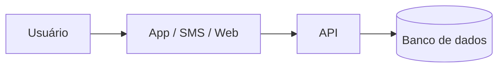

# Para detectar contas laranja de jovens com revisão humana, contestação rápida e prevenção


## Integrantes
| Nome completo (ordem alfabética) | GitHub | Área de carreira | RGM |
|---|---|---|---|
| [Kayk Alberto Santana Ferreira ] | [@Kayksantanaf] |  Engenharia de Dados | [RGM] |
| Maria Clara Farias Coelho] | [@mariaclarafarias1806-web] |  Engenharia de Dados | [RGM] |
| [Miguel Marcos Da Silva Gonçalves] | [@usuario] |  Engenharia de Dados | [RGM] |


**Dossiê:** 2 Crime organizado no ambiente digital: aliciamento online e contas laranja.
 
**Recorte:** Contas de pessoas de 16 a 24 anos em bancos digitais e fintechs, nas etapas de detecção precoce de contas laranja e de prevenção.

## 1. Análise do problema

### 1.1 

##  O que é afetado?
- **Pessoas:** golpes, manipulação, extorsão e exploração.
- **Crianças e adolescentes:** aliciamento e abuso online.
- **Sistema financeiro:** contas bancárias utilizadas para movimentar dinheiro ilícito.
- **Empresas e bancos:** fraudes e prejuízos financeiros.
- **Sociedade:** aumento da insegurança digital.

## Onde? 
- Redes sociais (Instagram, Facebook e TikTok).
- Aplicativos de mensagens (WhatsApp e Telegram).
- Jogos online.
- Plataformas bancárias e transferências digitais.

##  Dados e estatísticas

| Indicador | Dados |
|---|---|
| Exploração online | 19% dos jovens de 12 a 17 anos foram vítimas de exploração e/ou abuso sexual facilitados pela tecnologia em um ano. |
| Vítimas estimadas | Aproximadamente 3 milhões de crianças e adolescentes no Brasil. |
| Denúncias na internet | 49.336 denúncias entre janeiro e julho de 2025. |
| Contas laranja | 2,6 milhões de potenciais indivíduos ou contas identificados com indícios de atuação como laranjas em 2025. |
| Crescimento | Aumento de 62% em relação a 2023, segundo a Serasa Experian. |

## Exemplo real

**Operação Mandacaru – Polícia Federal (2025)**

- Investigação de organização criminosa envolvendo fraudes bancárias.
- Aproximadamente R$ 25 milhões movimentados em operações suspeitas.
- Utilização de contas digitais e pessoas como laranjas.

## O crime organizado digital prejudica pessoas, empresas e instituições financeiras. O aliciamento online facilita a exploração de vítimas, enquanto as contas laranja ajudam criminosos a movimentar dinheiro ilícito e dificultar sua identificação.

## Fontes de pesquisa

- [UNICEF](https://www.unicef.org/)
- [SaferNet Brasil](https://new.safernet.org.br/)
- [Serasa Experian](https://www.serasaexperian.com.br/)
- [Polícia Federal](https://www.gov.br/pf/pt-br)
- [Banco Central do Brasil](https://www.bcb.gov.br/)


### 1.2 Causas
[Destaque para as causas tecnológicas: sistemas, dados, redes, decisões de projeto]


## Causas Tecnológicas

O crime organizado no ambiente digital é facilitado por vulnerabilidades em sistemas, exposição de dados pessoais, redes de comunicação e falhas nas decisões de segurança das plataformas.

### Sistemas
- Falhas na verificação de identidade em cadastros digitais.
- Sistemas bancários vulneráveis a fraudes.
- Falta de mecanismos eficientes para detectar atividades suspeitas.

### Dados
- Vazamento de informações pessoais, como CPF, telefone e endereço.
- Uso indevido de dados roubados para abertura de contas falsas.
- Comercialização ilegal de informações pessoais.

### Redes e plataformas
- Redes sociais utilizadas para aliciamento de vítimas.
- Aplicativos de mensagens usados para organizar atividades criminosas.
- Jogos online utilizados para estabelecer contato e ganhar a confiança de menores.

### Decisões de projeto
- Falta de autenticação e verificação de identidade eficientes.
- Configurações de privacidade inadequadas.
- Moderação insuficiente de perfis e conteúdos criminosos.
- Falta de monitoramento de movimentações financeiras suspeitas.

### Conclusão
As vulnerabilidades tecnológicas e as falhas de segurança podem facilitar o aliciamento online e a utilização de contas laranja. Por isso, é importante investir em proteção de dados, sistemas de identificação seguros, monitoramento e fiscalização das plataformas digitais.


##  Fontes de pesquisa

- [ANPD – Autoridade Nacional de Proteção de Dados](https://www.gov.br/anpd/pt-br)
- [CERT.br – Segurança na Internet](https://cartilha.cert.br/)
- [Banco Central do Brasil](https://www.bcb.gov.br/)
- [SaferNet Brasil](https://new.safernet.org.br/)
- [UNICEF Brasil](https://www.unicef.org/brazil/)


### 1.3

##  O que já existe?

- **Disque 100:** recebe denúncias de violência e exploração contra crianças e adolescentes, inclusive pela internet.
- **SaferNet Brasil:** oferece denúncias anônimas de crimes digitais e orientação às vítimas.
- **Polícia Federal:** investiga crimes cibernéticos e organizações criminosas.
- **Comunica PF:** canal para comunicar crimes cibernéticos relacionados à exploração sexual infantil com repercussão internacional.
- **Conselho Tutelar:** atua na proteção de crianças e adolescentes vítimas de violência.
- **Bancos e instituições financeiras:** utilizam sistemas de monitoramento para identificar fraudes e movimentações suspeitas.
- **Plataformas digitais:** oferecem ferramentas para denunciar, bloquear perfis e remover conteúdos criminosos.

##  Por que não basta?

- Muitos crimes acontecem sem que as vítimas realizem denúncias.
- Criminosos utilizam perfis falsos e identidades de terceiros.
- A identificação de contas laranja pode ser difícil.
- As investigações podem envolver diferentes cidades e países.
- Novas tecnologias permitem que os criminosos mudem rapidamente suas estratégias.
- A prevenção e a fiscalização ainda precisam ser ampliadas.

##  O que poderia melhorar?

- Reforçar a segurança e a verificação de identidade em plataformas digitais e bancos.
- Melhorar o compartilhamento de informações entre instituições.
- Ampliar campanhas de educação e conscientização digital.
- Investir em tecnologias de identificação de fraudes.
- Facilitar os canais de denúncia e o atendimento às vítimas.

##  Conclusão

Apesar da existência de serviços públicos, organizações e ferramentas de proteção, o combate ao crime organizado digital ainda enfrenta desafios. É necessário fortalecer a prevenção, melhorar a segurança tecnológica e ampliar a cooperação entre empresas, bancos e autoridades policiais.

##  Fontes de pesquisa

- [Disque 100 – Governo Federal](https://www.gov.br/mdh/pt-br)
- [SaferNet Brasil](https://new.safernet.org.br/)
- [Polícia Federal](https://www.gov.br/pf/pt-br)
- [Comunica PF](https://www.gov.br/pf/pt-br/canais_atendimento/comunicacao-de-crimes)
- [Banco Central do Brasil](https://www.bcb.gov.br/)
- [Ministério da Justiça](https://www.gov.br/mj/pt-br)


## 2. Proposta tecnológica


### 2.1 A solução, do ponto de vista do usuário
[O que é, para quem, e como funciona passo a passo]


# Solução Proposta

##  O que é?
Uma plataforma digital de prevenção e conscientização contra o crime organizado no ambiente digital, com foco no aliciamento online e nas contas laranja.

## Para quem?
- Crianças e adolescentes.
- Pais e responsáveis.
- Jovens e adultos.
- Pessoas que utilizam bancos e redes sociais.

## Como funciona? (Passo a passo)

1. **Acesso:** o usuário entra na plataforma pelo celular ou computador.
2. **Informação:** consulta conteúdos sobre aliciamento online e contas laranja.
3. **Identificação:** aprende a reconhecer golpes e comportamentos suspeitos.
4. **Proteção:** recebe orientações para proteger seus dados pessoais e contas bancárias.
5. **Denúncia:** encontra os canais oficiais para denunciar situações suspeitas.
6. **Orientação:** recebe informações sobre como buscar ajuda e apoio das autoridades.

##  Objetivo
Utilizar a tecnologia para conscientizar, prevenir e ajudar a população a se proteger contra crimes digitais.


### 2.2 Arquitetura





[Que dados entram, onde ficam e quem acessa]


### 2.3 O trabalho de cada área


#### [Área 1]
#### [Área 2]
#### Como as áreas se complementam


### 2.4 O que a tecnologia não resolve


## 3. Análise ética


### 3.1 Matriz de riscos (mínimo 5)


| # | Risco | Classificação | Impacto (quem e quão grave) | Controle |
|---|---|---|---|---|
| 1 | | [ético / legal-privacidade / segurança / viés-inclusão / governança] | | |


### 3.2 Decisão
**[Implantar | Implantar com controles | Não implantar ainda]**
[Justificativa em até 10 linhas]


### 3.3 Controles antes de entrar em produção


| Eixo | Controle | Quem faz | Como saber que foi cumprido |
|---|---|---|---|
| Transparência | | | |
| Revisão humana | | | |
| Minimização de dados | | | |
| Segurança | | | |
| Teste de viés | | | |
| Canal de contestação | | | |


### 3.4 LGPD


| Dado pessoal | Finalidade | Base legal | Por quanto tempo | Sensível ou de criança/adolescente? |
|---|---|---|---|---|
| | | | | |


### 3.5 Comunicado público


> [Texto de até 600 caracteres para o LinkedIn da consultoria]


**Contagem:** [N] caracteres


## 4. Acessibilidade e inclusão digital


### 4.1 Quem pode ficar de fora


| Grupo | Barreira | O que a solução faz |
|---|---|---|
| | | |


### 4.2 Requisitos de acessibilidade
[Requisitos concretos, com o critério WCAG correspondente]


## 5. Sustentabilidade


### 5.1 Impacto ambiental da solução
### 5.2 Sustentabilidade do projeto
[Quem mantém, quem paga, o que acontece depois do primeiro ano]


## 6. Impacto esperado


### 6.1 Indicadores


| Indicador | Como medir | Meta | Prazo |
|---|---|---|---|
| | | | |


### 6.2 Como os usuários serão ouvidos
### 6.3 Se a solução não pegar


## 7. Quadro de decisões (mínimo 5)


| Decisão | Alternativas consideradas | Por que escolhemos esta |
|---|---|---|
| | | |


## 8. Capítulos individuais


### 8.1 [Nome do integrante] — [Área]


**Papel no projeto:** [pelo que respondeu e o que produziu]


**Plano de desenvolvimento**


| Competência que a solução exige | Técnica ou comportamental | Já tenho? |
|---|---|---|
| | | |


**Metas SMART (6 a 12 meses)**
1. [Específica, mensurável, atingível, relevante e com prazo]


**Feedback dos colegas**
[Avaliação construtiva e propositiva, escrita em conjunto pelos demais integrantes]


### 8.2 [Próximo integrante] — [Área]
### 8.3 [Próximo integrante] — [Área]
### 8.4 [Próximo integrante (se houver)] — [Área]
### 8.5 [Próximo integrante (se houver)] — [Área]


## 9. Referências


- [Autor ou órgão]. *[Título]*. [Veículo], [data]. [link]
````


